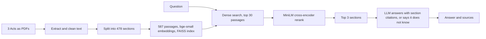

# MyLaw-RAG

Question answering over three Malaysian Acts, with an evaluation harness that measures every design choice instead of guessing.


**Live demo:** https://malaysian-law-rag.streamlit.app
(Hosted free on Streamlit Community Cloud. The demo runs retrieval only: it returns the most relevant sections with their full text. Answer generation is evaluated offline, see below. The app sleeps after 12 hours without visitors, so the first load can take a minute.)

<!-- Add a demo GIF here once recorded:

-->

**Corpus:** Employment Act 1955, Personal Data Protection Act 2010, Contracts Act 1950 (478 sections, split by section number, not by fixed-size windows).

> Not legal advice. The corpus uses reprints of the Acts: Employment Act as at 1 Jan 2023, PDPA as at 1 Jul 2023 (before the 2024 amendments), Contracts Act incorporating amendments up to 1 Jan 2007.

## How it works



- **Ingestion:** PyMuPDF text extraction, then removal of repeated headers and footers detected by frequency, then splitting at section numbers. Section 1 is located by its "may be cited as" sentence to skip each PDF's table of contents. Long sections are split into passages of at most 1,500 characters that keep their section number and heading.
- **Retrieval:** `BAAI/bge-small-en-v1.5` embeddings in FAISS, then a `cross-encoder/ms-marco-MiniLM-L-12-v2` reranker. Passages are collapsed to sections before scoring.
- **Generation:** the top 3 sections go to an LLM with strict rules: answer only from the excerpts, cite as `[Act s.X]`, otherwise reply "I don't know based on the provided Acts." Citations are parsed and checked against what was actually retrieved.

## Evaluation

**Questions:** 85 total. 51 *easy* (phrased close to the section headings), 28 *hard* (real-life scenarios in everyday language, e.g. "My landlord threatened to call the police unless I signed"), and 6 out-of-scope (e.g. "What is the minimum wage?"). Each answerable question has one or more gold sections, verified against the corpus text. A retrieval hit means any gold section appears in the top N sections.

### Retrieval

| Method | Easy Hit@1 | Easy Hit@5 | Easy MRR | Hard Hit@1 | Hard Hit@5 | Hard MRR |
|---|---|---|---|---|---|---|
| Dense (bge-small) | **0.863** | **0.980** | 0.902 | **0.357** | 0.571 | 0.443 |
| BM25 | 0.627 | 0.882 | 0.736 | 0.179 | 0.357 | 0.254 |
| Hybrid (dense + BM25, RRF) | 0.745 | 0.922 | 0.815 | 0.179 | 0.571 | 0.331 |
| **Dense + MiniLM rerank** | 0.843 | **0.980** | **0.904** | **0.357** | **0.679** | **0.510** |
| Dense + BGE-reranker-base | 0.706 | 0.941 | 0.809 | 0.286 | 0.607 | 0.434 |
| Hybrid + BGE-reranker-base | 0.784 | 0.961 | 0.851 | 0.286 | **0.679** | 0.438 |

What the numbers say:

- **Dense search beats BM25 and plain fusion.** Everyday questions and legal text share few words, so keyword matching can't bridge them. Hybrid fusion with equal weights diluted dense results instead of helping. (This vocabulary-mismatch explanation is a hypothesis; I did not test it directly.)
- **A cross-encoder reranker helps where it matters for RAG.** It does not improve Hit@1, but on hard questions it raises Hit@3 from 0.464 to 0.643 and Hit@10 from 0.679 to 0.821, which is what the LLM sees.
- **A bigger reranker was worse.** BGE-reranker-base lowered Hit@1 on easy questions from 0.863 to 0.706. I did not find out why.
- The chosen pipeline is dense retrieval plus MiniLM reranking.

All six methods were run on two different machines (a laptop and a Colab T4) and gave identical numbers.

### Answer quality

Run on all 85 questions with Qwen2.5-7B-Instruct (via Ollama on a Colab T4) as the generator.

| Measure | Result |
|---|---|
| Right section in the retrieved top 3 | 85% (67/79) |
| Answer cites a gold section: first-pass scorer | 72% (57/79) |
| Same, after fixing abstention detection (strict `[bracket]` format) | 77% (61/79) |
| Same, also counting inline mentions like "Contracts Act 1950 s.11" | 81% (64/79): easy 92%, hard 61% |
| When retrieval found the section: model used it | 96% (64/67) |
| When retrieval missed the section: model said "I don't know" | 50% (6/12) |
| Cited a section that was not in the retrieved text | 0 of 65 answers |
| Correct "I don't know" on out-of-scope questions | 83% (5/6) |

72% is the first-pass number. After reading the failures I changed the scorer twice, both times after seeing results: hedged answers that also contained "I don't know" had been counted as abstentions (77%), and correct answers that named the section in prose got no credit (81%). The fixes are legitimate scoring bugs, but treat 81% as the optimistic end.

### Where it fails

- **Retrieval is the bottleneck, not the LLM.** When the right section reaches the model it is used 96% of the time. The 15% of questions where retrieval misses are where answers go wrong.
- **Confident answers on thin context.** Half of the retrieval misses still got an answer. "My boss fired me with no warning after three years" retrieved s.14 and s.42 instead of the notice rules in s.12 and s.13, and the model answered from them.
- **One out-of-scope failure.** "Can I sue someone for defamation?" got a confident "Yes", citing an unrelated section about bailment. A real system needs to refuse when retrieval scores are low.
- **Partial answers.** In a manual spot check, "my landlord threatened to call the police unless I signed, can I cancel?" found the definition of coercion (s.15) but not the rule that such a contract is voidable (s.19), so the answer was hedged.

## Limitations

- 79 answerable questions: one question moves a hard-split number by about 3.6 points.
- I wrote the questions and gold labels myself. "Cites the gold section" is a proxy for correctness, not a check that the answer text is right.
- Answers were generated by a 7B open model; results will differ for other models.
- The corpus is a fixed set of reprints, some of them old (see above).

## Run it

Get the three Acts as English PDFs from the Attorney General's Chambers (lom.agc.gov.my) and save them as `data/raw/employment_act.pdf`, `pdpa.pdf` and `contracts_act.pdf`. The PDFs are not in the repo.

```bash
pip install -r requirements-dev.txt

python src/ingest.py        # PDFs -> data/processed/*.json
python src/chunk.py         # -> data/processed/chunks.jsonl (478 sections)
python src/index.py         # -> index/ (embeddings + FAISS)

python src/run_eval.py dense_rerank_minilm   # retrieval eval; also: dense, bm25, hybrid, dense_rerank_bge, hybrid_rerank_bge
python src/compare.py                        # side-by-side table

streamlit run app/ui.py     # demo (retrieval only unless an LLM is configured)
pytest -q                   # 46 tests, no model downloads needed
```

**Generated answers** need an LLM. `src/generate.py` uses the Claude API if `ANTHROPIC_API_KEY` is set, Groq if `GROQ_API_KEY` is set, and otherwise a local Ollama model (`OLLAMA_MODEL`, default `llama3.2`).

```bash
python src/generate.py "how many days of annual leave do I get after five years"
python src/eval_answers.py full     # answer eval over all 85 questions
python src/rescore.py               # separates retrieval failures from model failures
```

`notebooks/mylaw_rag_colab.ipynb` runs the whole pipeline and the answer eval on a free Colab GPU.

**Docker:** `docker build -t mylaw-rag . && docker run -p 7860:7860 mylaw-rag` (the image builds the search index at build time).

## Repo layout

```
src/        ingest, chunk, index, retrieve (dense, BM25, hybrid, rerank), generate,
            run_eval, eval_answers, rescore, compare
app/ui.py   Streamlit demo
eval/       questions.jsonl and saved results for every method
tests/      pytest suite (chunking, retrieval fusion, citation parsing, eval metrics, data checks)
```

## Future work

- Abstain when the top reranker score is low, to fix confident answers on thin context.
- Rewrite everyday questions into legal terms before retrieval (the hard split's main gap).
- Weighted fusion instead of equal-weight RRF.
- Faithfulness checking of the answer text, not just the cited section.
- Newer reprints, including the 2024 PDPA amendments.
